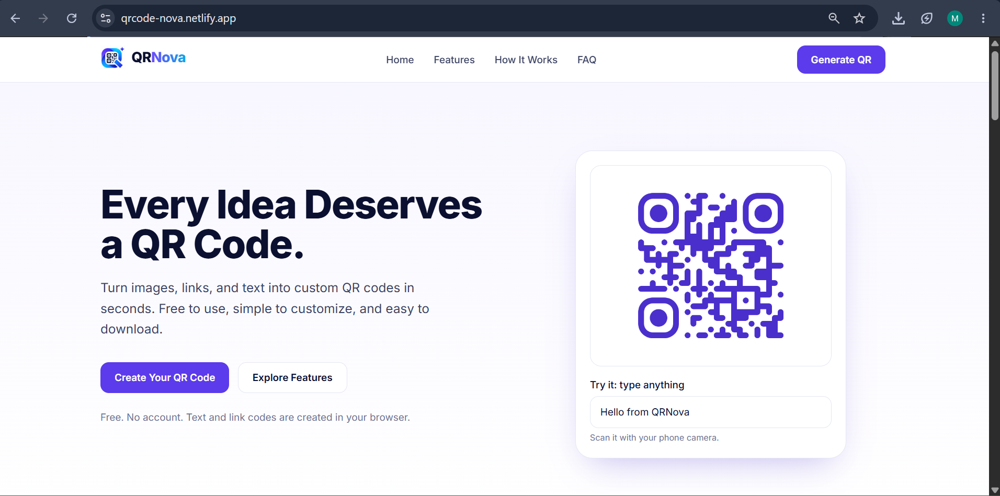
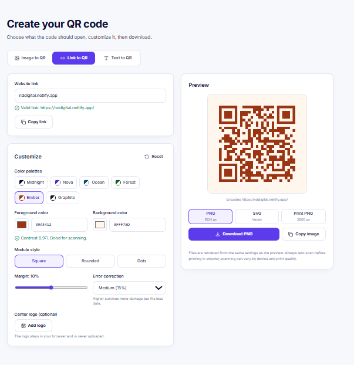
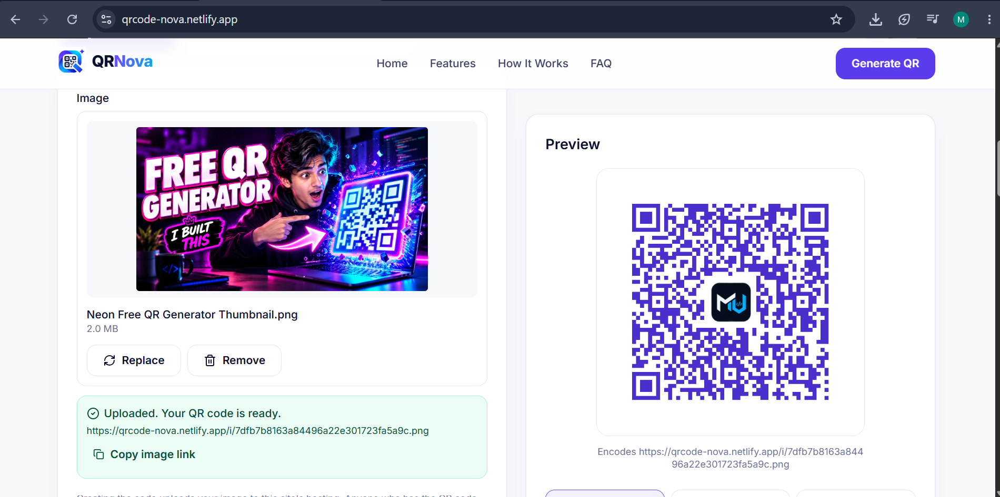
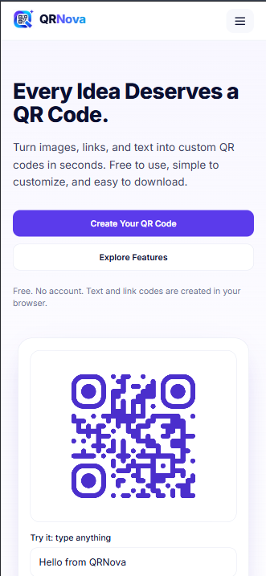
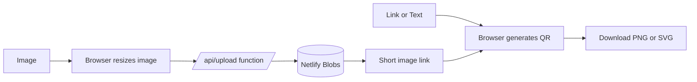

<div align="center">


<a href="https://qrcode-nova.netlify.app">
  
</a>

<br>

[](https://qrcode-nova.netlify.app)
[](https://youtu.be/GaBfLg3NSpk)
[](https://github.com/MUdevelops/QRNova/stargazers)


</div>

---

## 🎬 Video Demo

<div align="center">

[](https://youtu.be/GaBfLg3NSpk)

▶️ **Click the thumbnail to watch the full walkthrough**

</div>

---

## ✨ Features

| | Feature | Description |
|---|---|---|
| 🔗 | **Link to QR** | Paste any web address and get a scannable code |
| 📝 | **Text to QR** | Notes, Wi-Fi details, phone numbers, anything |
| 🖼️ | **Image to QR** | Upload a picture; scanning the code opens it |
| 🎨 | **Custom style** | Pick code color, background and dot shape |
| 🛡️ | **Error correction** | Low, Medium, Quartile or High |
| ⬇️ | **Export** | Download high-resolution PNG or vector SVG |
| ⚡ | **Instant preview** | The code updates live as you type |
| 🌗 | **Light and dark** | Follows your device theme, works on phones |
| 🆓 | **Free** | No sign-up, no watermark |

---

## 📸 Screenshots

<div align="center">

### 🏠 Home


<br><br>

### 🔗 Link to QR


<br><br>

### 🖼️ Image to QR


<br><br>

### 📱 Mobile view


</div>

> Put your screenshots in `docs/screenshots/` with the file names above.

---

## 🚀 Quick Start

```bash
# 1. Clone the repository
git clone https://github.com/MUdevelops/QRNova.git
cd QRNova

# 2. Install dependencies (needed for the Image tab functions)
npm install

# 3. Run locally with Netlify's dev server
npx netlify-cli dev
```

Open the local address shown in the terminal. Link and Text codes work on any static server. The Image tab needs `netlify dev` or a deployed site.

---

## ☁️ Deploy to Netlify

1. Push the project to your own GitHub repo.
2. In Netlify choose **Add new project → Import an existing project** and pick the repo.
3. Leave the build command empty. `netlify.toml` already sets the publish and functions folders.
4. Click **Deploy**.

---

## ⚙️ How It Works



- **Link and Text:** generated entirely in your browser. Nothing is sent to a server.
- **Image:** the image is shrunk in the browser, stored with a Netlify Function in Netlify Blobs, and the QR code points to `/i/<id>`.

---

## 📁 Project Structure

```
QRNova/
├── public/
│   ├── index.html        # App markup
│   ├── style.css         # Styling, light and dark themes
│   ├── app.js            # QR generation, export, image upload
│   ├── favicon.svg
│   └── assets/logo.svg
├── netlify/functions/
│   ├── upload.mjs        # POST /api/upload
│   └── image.mjs         # GET /i/:id
├── netlify.toml
└── package.json
```

---

## 🛠️ Built With

- **Frontend:** HTML, CSS, vanilla JavaScript
- **QR engine:** [qrcode-generator](https://github.com/kazuhikoarase/qrcode-generator)
- **Backend:** Netlify Functions + Netlify Blobs
- **Hosting:** Netlify

---

## 🗺️ Roadmap

- [ ] Logo in the center of the QR code
- [ ] Wi-Fi, vCard and email QR templates
- [ ] Image expiry and rate limiting
- [ ] Scan analytics

---

## 🤝 Contributing

Ideas and pull requests are welcome.

1. Fork the repo
2. Create a branch: `git checkout -b feature/my-idea`
3. Commit your changes and push
4. Open a pull request

---

## 👤 Author

**MUdevelops**

[](https://github.com/MUdevelops)

<div align="center">

⭐ **If QRNova helped you, give the repo a star!** ⭐


</div>
